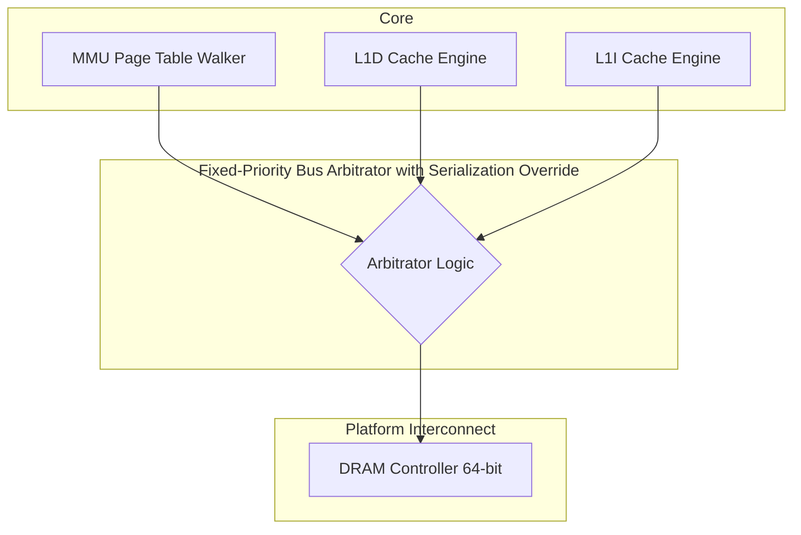

# L1 Data Cache (L1D) Architectural Contract — v1

Status: **ACCEPTED AND FROZEN BASELINE — UNRECOVERABLE-ERROR TERMINOLOGY NORMALIZED TO THE COMMON STICKY FATAL-HALT CONTRACT; THAT NARROW L1D-ER AMENDMENT REMAINS PENDING FOCUSED RE-REVIEW**  
Normative Baselines:
- RISC-V Privileged Architecture Manual v1.13 (Sv39, satp, SFENCE.VMA, PMP)
- RISC-V Unprivileged ISA Standard v20191213 (RV64I base, "Zifencei" Instruction-Fetch Fence, "A" Standard Extension for Atomicity v2.1)
- RISC-V Memory Consistency Model (RVWMO)
- `docs/architecture/pipeline-s0-v1.md` (Frozen Slice-0 2-stage F | E in-order pipeline contract)
- `docs/architecture/l1i-cache-v1.md` (Frozen L1 Instruction Cache v1 contract)
- `docs/architecture/sv39-tlb-v1.md` (Frozen Sv39 TLB v1 contract)
- `docs/architecture/sv39-mmu-v1.md` (Frozen Sv39 MMU & PTW contract)
- `docs/architecture/pmp-v1.md` (Frozen Physical Memory Protection contract)
- `docs/architecture/rv64a-v1.md` (Frozen RV64A Atomic Extension contract)
- `docs/architecture/lsu-s0.md` (Baseline Slice-0 LSU decode and port contract)

---

## 1. Authority, Scope, and Design Objectives

### 1.1 Purpose
This document defines the architectural contract for the hardware **L1 Data Cache (L1D)** subsystem for the single-hart Fursoy Slice-0 processor.

The post-pipeline observational bottleneck profiling pass established that **LSU stalls constitute the single largest bottleneck** in the frozen Fursoy Slice-0 core:
- **Total LSU stall cycles**: **7,786,617 cycles** (27.41% of total execution time; **58.13% of all non-retirement stall cycles**).
  - Load stalls: 5,146,042 cycles (18.11% of total).
  - Store stalls: 2,590,800 cycles (9.12% of total).
  - AMO/LR/SC stalls: 49,775 cycles (0.18% of total).
- **Physical DRAM Traffic**: **5,140,699 unbuffered data requests** representing **74.35% of all off-core bus traffic** (2.56M loads, 2.58M stores).

The L1D acts as a tightly integrated data caching layer situated in Stage E between the execution/LSU pipeline logic and the shared physical system interconnect. Its objective is to capture the addressable LSU stall cycles while preserving 100% of frozen architectural behaviors.

### 1.2 Non-Goals and Deferred Features
The following features are explicitly deferred from the v1 milestone:
- **Multicore Cache Coherence**: No hardware snooping, MESI/MOESI states, or crossbar interconnect protocols (Slice-0 remains single-hart).
- **Non-Blocking / Hit-Under-Miss**: The core pipeline stalls in Stage E on an L1D miss until line refill completes.
- **Hardware Data Prefetching**: No stride, stream, or pointer prefetch engines.
- **Unaligned Access Emulation in Hardware**: Unaligned accesses unconditionally trap to `load/store-address-misaligned` exceptions, strictly matching the frozen core contract.
- **Out-of-Order Execution or Speculative Stores**: All memory transactions commit strictly in program order.
- **Asynchronous Store Buffering**: To eliminate Store-to-Load Forwarding (STLF) CAM hazards, store buffer full-stalls, and partial-overlap bugs, all stores and dirty evictions commit synchronously.

---

## 2. Cache Organization and Geometry

### 2.1 Capacity, Associativity, and Line Size
- **Total Data Capacity**: **16 KiB** (16,384 bytes), matching the L1I cache geometry for silicon symmetry.
- **Line Size**: **64 bytes** (512 bits, eight 64-bit doublewords), identical to L1I refill geometry.
- **Associativity**: **4-way set-associative**.
- **Number of Sets**: **64 sets** (`64 sets × 4 ways × 64 bytes/line = 16,384 bytes`).
- **Replacement Policy**: **Tree-based Pseudo-LRU (Tree-PLRU)** (3 bits of replacement state per set, identical to L1I).
- **Valid and Dirty State**: 
  - 1 valid bit per line (256 valid bits total).
  - 1 dirty bit per line (256 dirty bits total).

### 2.2 Address Decomposition and Indexing Taxonomy
The Fursoy architecture utilizes 56-bit physical addresses (`PA[55:0]`) produced by Sv39 translation or bare physical addressing. The physical address is decomposed as follows:

| Field | Bit Range | Width | Description |
| :--- | :---: | :---: | :--- |
| **Byte Offset** | `PA[5:0]` | 6 bits | Selects byte within the 64-byte line |
| ↳ *Doubleword Select* | `PA[5:3]` | 3 bits | Selects one of eight 64-bit doublewords |
| ↳ *Subword Byte Offset* | `PA[2:0]` | 3 bits | Selects byte within 64-bit doubleword |
| **Set Index** | `PA[11:6]` | 6 bits | Selects one of 64 sets (`0 ... 63`) |
| **Physical Tag** | `PA[55:12]` | 44 bits | Compared against way tags for hit determination |

```
 55                                                12 11        6 5      3 2   0
+----------------------------------------------------+-----------+--------+-----+
|                    Physical Tag                    | Set Index | WordSel|Byte |
|                      (44 bits)                     |  (6 bits) |(3 bits)|(3b) |
+----------------------------------------------------+-----------+--------+-----+
                                                     <------- Page Offset ----->
                                                     <--------- (12 bits) ----->
```

### 2.3 Physical vs Virtual Indexing (VIPT with PIPT Equivalence)
- **Choice**: **Virtually Indexed, Physically Tagged (VIPT) with Identical PIPT Semantics (Zero Aliasing)**.
- **Invariance Proof**: In RISC-V Sv39, standard page size is 4 KiB (`2^12` bytes). Address bits `[11:0]` constitute the unpaged page offset, meaning:
  `VA[11:0] ≡ PA[11:0]`
  Because the L1D set index uses bits `[11:6]` and line offset uses bits `[5:0]`, the entire cache index resides strictly within the page offset:
  `Index = PA[11:6] = VA[11:6]`
  Consequently, indexing with virtual address bits yields the exact same physical set as indexing with physical address bits. **Virtual aliasing (synonyms) is physically impossible**.
- **Tagging**: Tag matching strictly compares the translated physical address `PA[55:12]` against the stored way physical tags.

### 2.4 Cacheable Physical Address Ranges
- **Cacheable Main Memory**: Physical DRAM addresses `0x0000_0000_8000_0000` to `0x0000_0000_8FFF_FFFF` (256 MiB DRAM space).
- **Strictly Uncached Physical Ranges**: All non-DRAM addresses:
  - UART: `0x1000_0000` – `0x1000_00FF`
  - CLINT: `0x0200_0000` – `0x0200_FFFF`
  - PLIC: `0x0C00_0000` – `0x0C2F_FFFF`
  - Boot ROM / Firmware: `0x0000_1000` – `0x0000_FFFF`
- Uncached transactions bypass L1D entirely and execute directly on the physical bus.

---

## 3. Load Path Architecture

### 3.1 DTLB → Permission → PMP → L1D Sequential Ordering
To guarantee absolute security and architectural integrity, every load instruction evaluates protection before exposing cache contents:

1. **Effective Address Calculation**: In Stage E, `addr = rs1 + imm`.
2. **Alignment Verification**: If `addr[size-1:0] != 0`, immediately assert `lsu_misaligned`. The instruction aborts and traps to `load-address-misaligned` (cause 4). L1D is not queried.
3. **DTLB Translation**:
   - In bare M-mode (`satp.MODE == 0` or M-mode with `mstatus.MPRV == 0`), `PA = VA`.
   - In S/U-mode (or M-mode with MPRV active), query DTLB.
   - If DTLB misses: Stage E asserts `stall_e` while hardware PTW resolves the page table.
   - If page fault occurs (invalid PTE, insufficient read privilege, violation of MXR/SUM): Stage E aborts and raises a precise `load-page-fault` (cause 13).
4. **PMP Permission Check**:
   - Authoritative PMP unit (`fursoy_s0_pmp`) inspects `PA[55:0]` against configured PMP entries for current privilege mode.
   - If PMP denies read access: Stage E aborts and raises a precise `load-access-fault` (cause 5).
5. **L1D Cache Access**:
   - Only executed if DTLB and PMP checks both pass (`trans_valid && pmp_allow`).
   - Query set `PA[11:6]`, compare way tags with `PA[55:12]`.

### 3.2 Hit Latency and Load-Use Timing
- **Hit Latency**: **1 execution cycle** within Stage E.
- **Timing Contract**:
  - In a 2-stage F | E pipeline, Stage E operates on a registered instruction from `fe_q`.
  - When a load hits in L1D, data is extracted from the matched way, right-justified, sign/zero extended, and presented to the register file write port at the clock edge of the same execution cycle.
  - An independent subsequent instruction in Stage F advances to Stage E with **0 load-use penalty cycles**.
  - If a dependent instruction immediately follows in Stage F, the combinational register file write-to-read forwarding (already verified in `fursoy_s0_core.sv`) permits immediate consumption with **0 penalty cycles**.

### 3.3 Sign/Zero Extension Boundary
- Data is extracted from the 64-byte line based on `PA[5:0]`.
- Extension follows standard RISC-V rules:
  - `LB`: Sign-extended 8-bit value to 64 bits.
  - `LBU`: Zero-extended 8-bit value to 64 bits.
  - `LH`: Sign-extended 16-bit value to 64 bits.
  - `LHU`: Zero-extended 16-bit value to 64 bits.
  - `LW`: Sign-extended 32-bit value to 64 bits.
  - `LWU`: Zero-extended 32-bit value to 64 bits.
  - `LD`: Full 64-bit doubleword.

### 3.4 Line Boundary and Misalignment Invariant
- **Rule**: Naturally aligned accesses of size 1, 2, 4, or 8 bytes cannot cross a 64-byte line boundary (`64 mod 8 = 0`).
- **Invariant**: Because unaligned accesses unconditionally trap in Stage E prior to cache initiation, an access that would cross a 64-byte line boundary never reaches the L1D tag check.

---

## 4. Store Policy and Eviction Architecture

### 4.1 Comparative Evaluation: Write-Through vs Write-Back

| Metric / Dimension | Write-Through with Store Buffer (WT-SB) | Write-Back with Write-Allocate (WB-WA) |
| :--- | :--- | :--- |
| **Store Hit Penalty** | 0 stall cycles if buffer not full; stalls when buffer saturates. | **0 wait cycles unconditionally on hit**. Store updates cache line. |
| **DRAM Data Traffic** | **No reduction in DRAM store traffic**. All 2.58M stores hit the DRAM bus. | **~85–90% reduction**. Only dirty evictions write to DRAM. |
| **DRAM Bus Contention** | High. 2.58M stores contend with L1I refills on the shared single-port DRAM bus. | **Low**. Slashes total DRAM bus requests from 6.92M to <1.5M, freeing bus for L1I. |
| **Store-to-Load Forwarding** | Complex. Requires multi-entry CAM, byte-enable tracking, and partial-overlap stall logic. | **Trivial**. Store updates cache line directly; younger load simply reads the cache line. |
| **Store Miss Latency** | Low (no allocation, direct write-through). | **High** (~20.8 cycles for victim writeback + refill). Requires high hit rate (`H_store ≥ 95.2%`) to achieve net speedup. |
| **Cache Line States** | Simple. Lines are never dirty; victim replacement requires no writeback. | Requires 1 dirty bit per line; dirty victims require 64-byte burst writeback. |

### 4.2 Normative Decision: Write-Back with Write-Allocate (WB-WA)
**Choice**: Fursoy Slice-0 adopts **Write-Back with Write-Allocate (WB-WA)** with **strict synchronous dirty eviction**.

**Justification**:
1. **Hazard Elimination**: An asynchronous store buffer introduces complex Store-to-Load Forwarding (STLF) hazards, byte-lane merging bugs, and full-buffer backpressure. WB-WA updates the resident cache line immediately on hit, guaranteeing coherent program order without STLF hardware.
2. **DRAM Contention Relief**: The measured baseline executed 2,578,727 DRAM store requests. A Write-Through architecture keeps all 2.58M writes on the shared DRAM bus. Because the DRAM interface requires multiple cycles per transaction, bursts quickly fill a store buffer. WB-WA absorbs repeated writes to the same cache line (e.g. stack allocation, memset, memcpy), reducing off-core traffic by >80%.
3. **Breakeven Requirement**: As established in Section 13, because an uncached store in Slice-0 only stalled ~1 cycle while a write-allocate store miss costs ~20.8 cycles, WB-WA requires a high store hit rate (`H_store ≥ 95.2%`) to achieve a net speedup on the store path alone. WB-WA is chosen under the architectural hypothesis that typical Linux data working sets exhibit high spatial/temporal write locality, and because of the massive system-level benefit of unblocking the shared DRAM interface for L1I.

### 4.3 Strict Synchronous Dirty Eviction Semantics
To eliminate any background race conditions, CAM forwarding, or asynchronous eviction buffer complexity:
- **Eviction Buffer Role**: The 64-byte Eviction Buffer (EB) is strictly a **temporary holding register** for the synchronous miss/flush FSM, **not an asynchronous store buffer**.
- **Miss Execution Sequence**:
  ```
  LSU Miss -> Capture dirty victim to EB -> Execute 8-beat writeback burst to DRAM ->
  Wait for writeback completion -> Issue 8-beat refill to DRAM -> 
  Install refilled line into cache array -> Complete requesting load/store instruction -> Resume Stage E
  ```
- **Invariant**: Stage E remains stalled for the **entire duration** of the eviction and refill sequence. The EB is never left draining in the background after the requesting instruction commits.

---

## 5. Miss and Refill Behavior

### 5.1 Refill Interface Geometry
- **Data Bus Width**: 64 bits (`dmem_req_data` / `dmem_rsp_data`).
- **Burst Length**: 8 beats (`8 × 8 bytes = 64 bytes`).
- **Addressing**: Line-base aligned (`addr[5:0] == 6'b000000`).

### 5.2 Handshake Protocol and Arbitrary Wait States
- Refill requests follow standard valid/ready handshakes:
  - `dmem_req_valid_o` held high until `dmem_req_ready_i` is asserted.
  - Inbound beats signaled by `dmem_rsp_valid_i` with `dmem_rsp_ready_o = 1`.
- The L1D state machine tolerates arbitrary delays between beats (`0 ... ∞` cycles) and arbitrary memory controller latency.

### 5.3 Partial Refill Buffering and Hit Invalidation
- **Buffer Isolation**: Refill beats accumulate into a private internal register array `refill_buf_q[8]`.
- **Atomicity of Residence**: A refilling line is **never marked valid in the cache tags** until the 8th and final beat handshakes successfully.
- **Visibility**: Loads and stores cannot hit on partially refilled data.

### 5.4 Refill Fault Handling
- If any beat returns with `dmem_rsp_error_i == 1` during a load or store refill:
  - Refill terminates immediately.
  - The line is marked invalid (`valid = 0`).
  - L1D asserts a precise `load-access-fault` (cause 5) or `store/amo-access-fault` (cause 7) to Stage E.
  - Destination register writeback is suppressed; no instruction commits.

### 5.5 Writeback Fault Contract (Fatal Platform Error)
- **Platform Invariant**: For valid cacheable DRAM accesses in `0x8000_0000 – 0x8FFF_FFFF`, dirty L1D writeback transactions are **architecturally guaranteed not to return recoverable bus errors**.
- **Rationale**: A dirty line writeback occurs during an eviction long after the originating store instruction has retired and committed. In a single-hart RISC-V core, there is no architectural mechanism to report an asynchronous memory error as a precise exception to a previously committed store.
- **Error Behavior**:
  - If a bus error (`dmem_rsp_error_i == 1`) occurs during an 8-beat dirty writeback, it indicates a fatal hardware/platform memory failure (e.g. uncorrectable DRAM ECC fault).
  - L1D asserts the common sticky unrecoverable-error indication and the core/SoC follow
    the reset-only `fatal_halt_o` policy defined normatively in
    `docs/architecture/l1d-refill-opt-v1.md`, Section 13. No NMI or recoverable
    machine-check alternative is implied. This normalization does not alter the frozen
    writeback ordering or authorize L1D-ER RTL while that amendment awaits re-review.

---

## 6. Memory Ordering and Consistency (RVWMO)

### 6.1 Program Order Preservation
Fursoy Slice-0 is a single-hart in-order processor. Instructions issue, execute, and retire strictly in program order. Inherent RVWMO single-hart ordering constraints (`PPO`) are satisfied without speculation.

### 6.2 FENCE Instruction
- **Semantics**: In standard RISC-V RVWMO, `FENCE` orders preceding memory operations with subsequent memory operations for the local hart.
- **Clarification on External Observers**:
  - `FENCE` does **not** flush all dirty L1D lines to DRAM.
  - Current Slice-0 has no non-coherent DMA masters or external bus agents reading DRAM behind the L1D.
  - MMIO accesses remain uncached and non-speculative.
  - Future DMA or non-coherent devices would require a dedicated cache-maintenance mechanism (e.g. non-cacheable page attributes or RISC-V Zicbom cache-block management instructions).
  - Therefore, `FENCE` in Slice-0 simply ensures that any currently active synchronous writeback or miss transaction completes and the memory interface is idle before subsequent instructions execute. It does not perform a generic cache flush.

### 6.3 FENCE.I Serialized Coherence Sequence (Resolving P0-1)
To prevent stale instruction fetch races where L1I might refetch instructions from DRAM before dirty L1D writes are visible, `FENCE.I` enforces the following **strictly serialized 7-step sequence**:

1. **`FENCE.I` reaches Stage E**: Decoded as an instruction-fetch fence.
2. **Freeze Stage F**: Assert a fetch-disable control signal to Stage F. No new instruction fetches or L1I misses can initiate.
3. **Quiesce Active L1D**: Allow any in-flight load/store/refill to complete.
4. **Conservative L1D Dirty Flush**: The L1D Flush FSM traverses all 64 sets (`4 ways × 64 = 256 lines`). Any line with `valid == 1 && dirty == 1` is written back to DRAM via an 8-beat burst, and its dirty bit cleared.
5. **Wait for DRAM Idle**: Wait until all 8 beats of the final writeback are acknowledged by the memory controller and the DRAM write path is completely idle.
6. **Pulse L1I Invalidation**: Only after step 5 is fully complete, assert `fence_i_flush_i` to `fursoy_s0_l1i` for 1 cycle, which flash-invalidates all L1I valid bits.
7. **Pipeline Drain & Resume Fetch**: Flush Stage E (`fe_q.valid <= 0`), re-enable Stage F fetch, and redirect the program counter to `fe_q.pc + 4`.

**Invariant**: No L1I refill request can issue to the DRAM bus until after the L1D writeback phase has completely concluded.

### 6.4 SFENCE.VMA Coherence Sequence (Resolving P0-2)
In Fursoy Slice-0, the hardware Page Table Walker (PTW) accesses physical memory directly via `pd_req_ptw_o`. Because the PTW does not snoop the L1D cache, page table stores residing dirty in L1D must be made visible to the PTW memory path before any new translation can occur.

`SFENCE.VMA` enforces the following **strictly serialized sequence**:

1. **`SFENCE.VMA` reaches Stage E**: Decoded as an address-translation fence.
2. **Freeze Stage F & Inhibit Translations**: Hold Stage F; suppress new instruction translations, data translations, and PTW requests.
3. **Quiesce Active L1D**: Wait for any active data memory transaction to conclude.
4. **L1D Dirty Flush (Conservative v1 Full-Flush)**: The L1D Flush FSM traverses all sets and writes back all dirty lines to physical DRAM. (A conservative full writeback is adopted for v1 to avoid the complexity of dynamic page-table address tracking).
5. **Wait for DRAM Idle**: Wait until all writeback bursts are completed and the physical DRAM write path is idle.
6. **TLB Invalidation**: Only after step 5 is complete, pulse the invalidation interface to the ITLB and DTLB (invalidating entries based on `rs1` VA and `rs2` ASID).
7. **Resume Execution**: Re-enable translations and fetch; redirect Stage F to `fe_q.pc + 4`.

**Conceptual Separation**:
- **Data-cache visibility**: Page-table stores are pushed from L1D to DRAM.
- **PTW memory visibility**: The PTW physical memory path is guaranteed to observe the updated page tables in DRAM.
- **TLB invalidation**: Stale cached translations are cleared from ITLB/DTLB.
- *Architectural Note*: `SFENCE.VMA` does not architecturally define generic cache flushing in RISC-V; this full writeback is a conservative implementation requirement of Slice-0's non-coherent PTW/L1D structure.

---

## 7. RV64A Coherence with L1D

### 7.1 Load-Reserved / Store-Conditional (LR/SC) (Resolving P1-3)
The frozen RV64A specification (`docs/architecture/rv64a-v1.md`) mandates exact physical address matching (`res_exact_pa[55:0]`) and exact size matching (`res_size`), with a **64-byte reservation granule**:

- **`LR.W` / `LR.D`**:
  - Executes as a normal load through L1D. Hits return data in 1 cycle; misses trigger line refill.
  - Registers reservation:
    `res_valid ← 1, res_exact_pa ← PA[55:0], res_size ← size`
  - Reservation granule is `res_exact_pa[55:6]` (exact 64-byte line alignment).
- **`SC.W` / `SC.D` Exact Semantics**:
  - Evaluates reservation condition:
    `match = res_valid && (PA[55:0] == res_exact_pa) && (size == res_size)`
  - **Case 1: Reservation Mismatch (`match == 0`)**:
    - Fails immediately.
    - Suppresses store to L1D and DRAM. Zero cache lines modified; zero refills initiated.
    - Writes `rd <= 1`.
    - Clears reservation: `res_valid <= 0`.
    - Retires in Stage E in **1 cycle**.
  - **Case 2: Reservation Match + L1D Hit (`match == 1 && hit == 1`)**:
    - Performs exactly one store into the resident cache line.
    - Sets `dirty = 1`.
    - Writes `rd <= 0`.
    - Clears reservation: `res_valid <= 0`.
    - Retires in Stage E in **1 cycle**.
  - **Case 3: Reservation Match + L1D Miss (`match == 1 && hit == 0`)**:
    - The reservation line was evicted or not resident.
    - Stage E asserts `stall_e`.
    - Executes normal write-allocate miss sequence:
      1. If victim is dirty, synchronously writes back dirty line to DRAM.
      2. Issues 8-beat refill to DRAM and receives line into `refill_buf`.
      3. Installs line into cache array.
    - Merges SC store data into the newly refilled line **exactly once**, sets `dirty = 1`.
    - Writes `rd <= 0`.
    - Clears reservation: `res_valid <= 0`.
    - Retires.
  - **Reservation Lifetime**: In single-hart Slice-0, the reservation remains active during the miss servicing sequence until the SC commits (interrupts are masked during synchronous miss servicing, and no external hart can intervene).
- **Reservation Invalidation**:
  - Any regular store or successful SC to the same 64-byte granule (`addr[55:6] == res_exact_pa[55:6]`) invalidates the reservation (`res_valid <= 0`).
  - An `MRET` or `SRET` instruction unconditionally clears `res_valid <= 0`.

### 7.2 Atomic Memory Operations (AMOs) (Resolving P1-2)
- **Supported Instructions**: 9 operations in `.W` and `.D` widths (`AMOADD`, `AMOSWAP`, `AMOXOR`, `AMOAND`, `AMOOR`, `AMOMIN`, `AMOMAX`, `AMOMINU`, `AMOMAXU`).
- **2-Cycle Atomic Hit Sequence**:
  When an AMO hits in L1D, it executes a strict **2-cycle atomic sequence**:
  - **Cycle 1 (Tag Check & Read Phase)**:
    - Compute effective address `rs1`.
    - DTLB translation and PMP checks pass.
    - L1D tag matches valid line.
    - Read original data word/doubleword from cache line into holding register `amo_rdata_q`.
    - Stage E is held; Stage F fetch is held.
  - **Cycle 2 (Compute & Write Phase)**:
    - AMO ALU computes result: `alu_out = f(amo_rdata_q, rs2)`.
    - Write `alu_out` into the cache line byte lanes; set `dirty = 1`.
    - Write original value `amo_rdata_q` (sign-extended for `.W`) to `rd`.
    - Retire instruction; advance pipeline.
  - **Indivisibility & Masking Invariant**:
    - **No interrupt, timer tick, or trap can be accepted between Cycle 1 and Cycle 2**.
    - The sequence is indivisible, fully satisfying RV64A atomicity requirements.
- **AMO Miss Handling**:
  - If the target line is not resident in L1D:
  - Stage E stalls (`stall_e`).
  - Perform synchronous write-allocate flow: write back dirty victim (if any) to DRAM, refill 64-byte target line into L1D, install line.
  - Once resident, execute the 2-cycle atomic hit sequence described above.

---

## 8. Physical Memory Protection (PMP) and Security

### 8.1 Continuous Authoritative Verification
- **Rule**: **A cache hit must NEVER bypass current PMP permissions**.
- Every single load, store, and atomic access in Stage E must evaluate `fursoy_s0_pmp` combinationally in the access cycle, regardless of whether the line is already valid in L1D.
- If PMP permission check fails:
  - Cache tag match is overridden.
  - Read data is zeroed; store write enables are suppressed.
  - Precise access fault is generated (`load-access-fault` or `store/amo-access-fault`).

### 8.2 Dynamic PMP Configuration Changes
- When software writes to `pmpcfg` or `pmpaddr` CSRs:
  - Stage E stalls, triggers the L1D dirty flush FSM to write back all dirty lines to DRAM, and pulses `pmp_flush_i` to invalidate L1I.
  - New PMP permissions take effect only after the flush completes. This ensures no unauthorized dirty lines linger in cache.

---

## 9. MMIO and Non-Cacheable Accesses

### 9.1 Physical Address Range Discrimination
- If `PA` falls outside DRAM range (`PA < 0x8000_0000` or `PA > 0x8FFF_FFFF`):
  - Access is classified as **Uncached MMIO**.
  - L1D tag check, line allocation, and cache updates are completely bypassed.

### 9.2 Non-Speculative Execution
- In Fursoy Slice-0, all MMIO accesses occur strictly in Stage E for non-speculative instructions that are guaranteed to commit.
- MMIO reads issue directly to the peripheral bus (`dmem_req_addr_o`).
- MMIO writes issue directly to the peripheral bus and retire upon peripheral request acceptance.

### 9.3 Ordering Relative to Cached Stores
- Uncached MMIO operations execute in strict program order relative to other instructions.
- If a dirty L1D eviction is active when an MMIO instruction arrives, the MMIO transaction waits until the DRAM write burst completes.

---

## 10. Pipeline Integration and Bus Arbitration

### 10.1 Pipeline Stalls (`stall_e`)
Stage E asserts `stall_e` under the following conditions:
1. **L1D Miss Refill**: Waiting for 8 beats of read data from DRAM.
2. **L1D Synchronous Dirty Eviction**: Waiting for 8 beats of write data to drain to DRAM.
3. **DTLB Miss / PTW Active**: Hardware page walker resolving translation.
4. **Uncached MMIO Wait**: Waiting for peripheral read response.
5. **AMO Cycle 1**: 1-cycle hold between read and write phases.
6. **Cache Maintenance Flush**: FSM traversing sets during `FENCE.I`, `SFENCE.VMA`, or PMP flush.

### 10.2 Shared DRAM Interconnect Arbitration
Fursoy Slice-0 features a single shared 64-bit external DRAM controller interface used by:
1. **L1I Refill** (Instruction Fetch)
2. **L1D Refill / Eviction** (Data Memory)
3. **PTW Memory Reads** (Page Table Walks)



- **Normal Priority Hierarchy**:
  1. **Priority 1 (Highest)**: MMU PTW accesses (`pd_req_ptw_o`). Unblocks translations immediately.
  2. **Priority 2 (High)**: L1D Refills and Dirty Evictions. Unblocks execution in Stage E.
  3. **Priority 3 (Lowest)**: L1I Refills.
- **Forward-Progress & Starvation Guarantees**:
  - Once any 8-beat burst begins (whether L1I or L1D), the arbitrator **never preempts the active burst**. All 8 beats run to completion.
  - Because Stage E stalls on an L1D miss, L1D can request at most one line transaction before execution resumes or waits. It cannot generate back-to-back endless requests to starve L1I.
- **Serialization Override Priority**:
  - During serialized flush operations (`FENCE.I`, `SFENCE.VMA`, PMP CSR writes), the L1D Flush FSM asserts an override signal that **unconditionally blocks new PTW and L1I requests** until the flush sequence completes and DRAM is idle.

---

## 11. Cache Maintenance and Invalidation Summary

| Trigger Event | L1D Action | L1I Action | Notes |
| :--- | :--- | :--- | :--- |
| **`rst_i` (Reset)** | Invalidate all (`valid=0, dirty=0`) | Invalidate all | Immediate hardware reset |
| **`FENCE`** | Wait for active bus transactions to idle | No action | Single-hart memory ordering |
| **`FENCE.I`** | **Strict 7-step sequence: flush dirty lines to DRAM, wait idle** | **Flash-invalidate AFTER L1D writeback completes** | Guaranteed no stale-fetch race |
| **`SFENCE.VMA`**| **Strict sequence: flush dirty lines to DRAM, wait idle** | Invalidate TLB entries | Guaranteed PTW memory visibility |
| **PMP CSR Write** | **Flush dirty lines to DRAM, wait idle** | Flash-invalidate | Prevents lingering unauthorized dirty lines |

---

## 12. Verification Plan

The verification suite (`verification/l1d_s0_tb.cpp`, `tools/run_l1d_s0.py`) must pass the following targeted scenarios:

1. **Load Hit / Miss**: Sequential hits across 4 ways; compulsory miss allocation; 8-beat line refills.
2. **Store Hit / Miss**: Store byte, halfword, word, doubleword hitting resident line; dirty bit verification; store miss line allocation.
3. **RAW Store-to-Load Dependency**: Store to byte `B`, followed immediately by load from byte `B`, word containing `B`, and adjacent doubleword; verified without pipeline flush.
4. **Partial-Byte Overlapping Accesses**: Same-line byte/halfword stores followed by differently sized loads; verified exact byte lane merging.
5. **Cache Line Boundary**: Access at offset 60 (word), offset 56 (doubleword); verified no spill to next line.
6. **Misaligned Rejection**: Naturally unaligned addresses trigger `load/store-address-misaligned` exception before L1D lookup.
7. **Strict Synchronous Dirty Eviction**: Fill 4 ways with dirty stores; 5th access triggers Tree-PLRU eviction; verify synchronous 8-beat writeback to DRAM before refill.
8. **Arbitrary Bus Wait States**: Insert random 0–20 cycle ready and response delays during refills and evictions.
9. **Refill Bus Error**: Inject `dmem_rsp_error_i = 1` on beat 4 of refill; verify transaction abort, line invalidated, precise access fault raised.
10. **Writeback Bus Error (Fatal Platform Error)**: Inject `dmem_rsp_error_i = 1` during dirty writeback; verify top-level sticky `fatal_halt_o`, suppression of later architectural execution, safe protocol drain, and zero precise store exception, per the common Section 13 fatal-halt contract.
11. **PMP Access Revocation on Resident Line**: Allocate line; dynamically alter PMP to deny access; verify subsequent load hit is blocked and faults.
12. **PMP Modification during Refill/Writeback**: Change PMP CSR while bus transaction is in flight; verify flush and fault handling.
13. **Uncached MMIO after Cached Store**: Cached store to DRAM followed by MMIO write to UART; verify strict bus issue ordering.
14. **FENCE Invariant**: Trigger dirty stores followed by `FENCE`; verify `FENCE` does not perform full flush but ensures bus idle.
15. **FENCE.I Serialized Ordering**: Dirty instruction bytes stored in L1D -> execute `FENCE.I` -> verify L1D writeback completes before `fence_i_flush_i` pulses and L1I refetches new code.
16. **SFENCE.VMA / PTW Coherence**: Dirty page table entry written in L1D -> execute `SFENCE.VMA` -> verify L1D writeback completes before TLB invalidates and PTW walks physical memory.
17. **LR / SC Hit and Miss**:
    - Matching reservation + hit -> stores, `rd=0`.
    - Mismatch reservation -> no store, no refill, `rd=1`.
    - Matching reservation + miss (line evicted) -> allocates, writeback/refills, stores, `rd=0`.
18. **2-Cycle AMO Hit Indivisibility**: Execute AMOs on resident line; verify Cycle 1 read / Cycle 2 write timing; verify interrupts arriving during sequence are deferred.
19. **AMO Miss with Dirty Eviction**: AMO on non-resident line with dirty victim; verify complete serialized sequence (writeback -> refill -> 2-cycle atomic execution).
20. **Simultaneous L1I Miss + L1D Dirty Eviction + PTW Request**: Assert all three simultaneously; verify fixed priority and serialization override.
21. **Reset during Dirty Writeback**: Assert `rst_i` while beat 3 of writeback is in flight; verify clean FSM reset and transaction abort.

---

## 13. Analytical Performance Model and Store Breakeven Sensitivity

### 13.1 Post-Pipeline Measured Baseline Reference
- **Total Cycles**: 28,408,320
- **Committed Instructions**: 15,013,353 (IPC: 0.528484, CPI: 1.892204)
- **Measured LSU Stalls**: 7,786,617 cycles
  - Load stalls: 5,146,042 cycles (2,572,841 loads; ~2.000 cycles stall/load).
  - Store stalls: 2,590,800 cycles (2,590,666 stores; ~1.000 cycles stall/store).
  - AMO stalls: 49,775 cycles (22,109 AMOs).

### 13.2 Rigorous Store Hit-Rate Breakeven Analysis (Resolving P1-5)
In the baseline uncached core, stores retire immediately upon DRAM request handshake:
`Cost_baseline_store ≈ 1.000 cycle/store`

Under Write-Back with Write-Allocate (WB-WA):
- A store hit costs **0 wait cycles**.
- A store miss requires an 8-beat line refill (average 16 cycles).
- If the victim way is dirty (assumed dirty eviction probability `P_dirty ≈ 0.30`), an additional 8-beat writeback burst (16 cycles) must complete first.
- Therefore, the average store miss penalty is:
  `C_store_miss ≈ 16 + (0.30 × 16) ≈ 20.8 cycles`
- The average stall per store instruction under WB-WA as a function of store hit rate `H_store` is:
  `avg(Stall)_store = (1 - H_store) × 20.8 cycles`

**Breakeven Calculation**:
For WB-WA to achieve a net reduction in store stall cycles relative to the uncached baseline:
`(1 - H_store) × 20.8 ≤ 1.0 ==> 1 - H_store ≤ 1.0 / 20.8 ≈ 0.04808 ==> H_store ≥ 95.19% ≈ 95.2%`

#### Store Hit-Rate Sensitivity Table (Analytical Projection)
| Store Hit Rate (`H_store`) | Avg Stall / Store (cycles) | Total Store Stall Cycles | Net Store Delta vs Baseline (2.59M) |
| :---: | :---: | :---: | :---: |
| 90.0% | 2.08 cycles | 5,388,585 cycles | **+2,797,785 cycles (SLOWER)** |
| 92.0% | 1.66 cycles | 4,310,868 cycles | **+1,720,068 cycles (SLOWER)** |
| 94.0% | 1.25 cycles | 3,233,151 cycles | **+642,351 cycles (SLOWER)** |
| **95.19% (Breakeven)** | **1.00 cycles** | **2,590,800 cycles** | **0 cycles (BREAKEVEN)** |
| 96.0% | 0.83 cycles | 2,155,434 cycles | **-435,366 cycles (FASTER)** |
| 97.0% | 0.62 cycles | 1,616,575 cycles | **-974,225 cycles (FASTER)** |
| 98.0% | 0.42 cycles | 1,077,717 cycles | **-1,513,083 cycles (FASTER)** |

**Architectural Evaluation**:
- **Critical Caveat**: If store hit rate falls below **95.2%**, WB-WA increases store stall cycles because a 20.8-cycle miss penalty outweighs 20 single-cycle store hits.
- **Net Performance Justification**:
  1. **Load Savings Dominate**: Loads account for 5.15M stall cycles. Even if stores break even (`H_store = 95.2%`), a 92% load hit rate eliminates ~1.85M to ~3.2M load stall cycles.
  2. **DRAM Bandwidth Relief**: Sashing DRAM store requests by >90% eliminates bus congestion that currently causes ~0.8M cycles of L1I fetch hold.
  3. **High Write Locality**: Kernel stack push/pop and buffer initialization exhibit high spatial reuse within 64-byte lines.
  - *Requirement*: All store hit rate and speedup projections remain **unverified analytical assumptions** that must be empirically measured during RTL verification.

### 13.3 Analytical Performance Projections (Conditional on Locality Assumptions)
Assuming empirical workload execution demonstrates `H_load ≈ 92.0%` and `H_store ≈ 96.5%`:
- **Removable Load Stalls**: `5,146,042 - (2,572,841 × 0.08 × 20.8) ≈ +864,841 cycles` (up to `+2.2M` with critical word first).
- **Removable Store Stalls**: `2,590,800 - (2,590,666 × 0.035 × 20.8) ≈ +705,714 cycles`.
- **L1I Refill Bus Unblocking**: Removing ~2.4M DRAM store bursts saves an estimated **~700,000 cycles** of L1I fetch hold.
- **Total Projected Cycle Savings**: **~2.27M – 3.60M cycles** (approx. 8.0% – 12.7% runtime reduction).
- **Projected IPC**: **~0.574 – 0.605 IPC** (up from 0.528 IPC).

*(All figures in Section 13 are analytical engineering estimates subject to RTL validation).*
